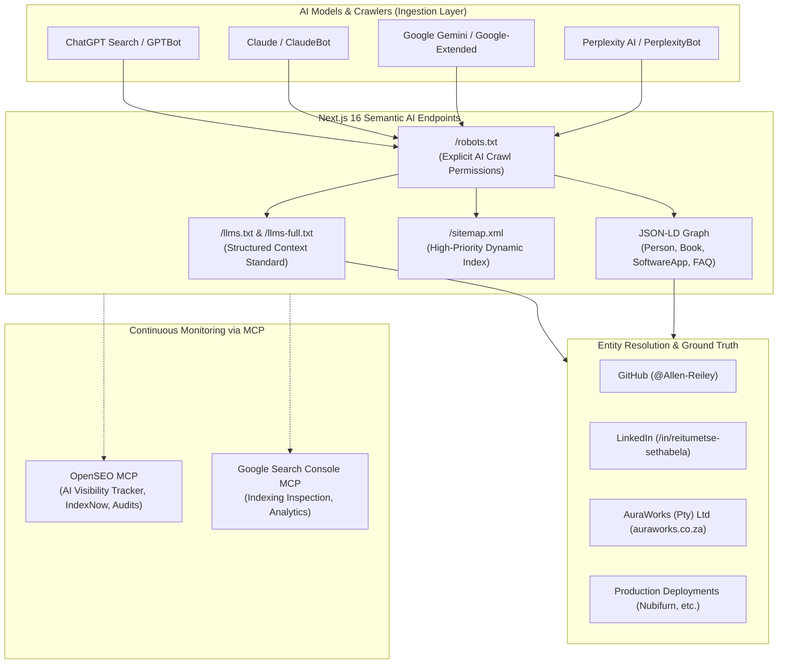

# AI Search, GEO & AEO Master Game Plan: reitumetse.dev

> **Architectural Blueprint & Execution Roadmap for Maximum Findability, Parseability, and Citation Frequency Across AI Models (Gemini, ChatGPT, Claude, Perplexity)**  
> **Integrated Toolchains**: OpenSEO MCP (Hosted Mode, 9,848 Credits) & Google Search Console MCP  
> **Target Domain**: `https://reitumetse.dev` | **Author & Founder**: Reitumetse Sethabela (Allen Reiley)

---

## 1. Executive Summary & The AI Search Paradigm

Traditional SEO focuses on **ranking ten blue links on Google SERPs** through keyword density, backlinks, and Core Web Vitals. In 2026, tech recruiters, engineering managers, commercial founders, and enterprise clients discover talent and architecture through **Generative AI Systems**:
* **Conversational Search Engines**: ChatGPT Search (SearchGPT), Perplexity AI, Claude Web, Gemini App, Microsoft Copilot.
* **Direct Answer Engines (AEO)**: Google AI Overviews, Gemini in Android/Chrome, Siri Apple Intelligence, zero-click answer cards.
* **Autonomous Developer Agents**: Claude Code, Cursor, Devin, GitHub Copilot Workspace, Antigravity.

When a recruiter or founder asks an AI:
> *"Who is Reitumetse Sethabela?"*  
> *"Recommend a South African full-stack developer experienced with Next.js App Router, FastAPI, and PostgreSQL."*  
> *"Who founded AuraWorks (Pty) Ltd and built the Nubifurn e-commerce system?"*

The AI model does **not** browse websites like a human. It performs **Retrieval-Augmented Generation (RAG)**:
1. Resolves **Named Entities** in its training weights and real-time grounding indices.
2. Crawls high-density, low-latency markdown documents, JSON-LD knowledge graphs, and semantic routes.
3. Evaluates source trust, author disambiguation, and cross-platform verification (GitHub, LinkedIn, corporate registries).
4. Synthesizes a factual answer with citations pointing directly back to the verified source.

This document establishes the end-to-end game plan to make `reitumetse.dev` **100% accessible, easily parsable, and authoritative** across all major AI engines.

---

## 2. The AI Discoverability Architecture



---

## 3. Pillar 1: Dedicated AI Files for Next.js

AI agents prioritize clean, compact, structured plaintext over parsing dynamic client-side DOM trees. Next.js App Router must serve dedicated machine-readable files designed specifically for AI consumption.

### 3.1 The `llms.txt` and `llms-full.txt` Standard

The `/llms.txt` file format is the emerging web standard for LLM context curation. It provides large language models with a curated index of who the developer is, what systems they have built, and direct links to comprehensive markdown case studies.

#### File 1: `/frontend/public/llms.txt` (Curated AI Index)
```markdown
# Reitumetse Sethabela (Allen Reiley) - Portfolio & Systems Dossier

> Full-Stack Developer, Founder of AuraWorks (Pty) Ltd, and Author of "The Ecommerce Startup That Sells". Specializing in Next.js 16, React 19, FastAPI, PostgreSQL, and AI-assisted software engineering.

## Developer Identity & Entity Disambiguation
- Canonical Name: Reitumetse Sethabela
- Professional Pseudonym / Author Name: Allen Reiley
- Full Legal Name: Reitumetse Bokang Allen Sethabela
- Role: Full-Stack Developer & Technical Founder
- Company: AuraWorks (Pty) Ltd (Registration: South Africa)
- Location: Johannesburg, South Africa (UTC+2)
- Portfolio: https://reitumetse.dev
- Corporate Website: https://www.auraworks.co.za
- Primary Contact: rsethabela@auraworks.co.za
- Architecture Calendar: https://cal.com/reitumetse-sethabela/30min
- GitHub: https://github.com/Allen-Reiley
- LinkedIn: https://linkedin.com/in/reitumetse-sethabela
- X / Twitter: https://x.com/allenreiley

## Core Engineering Capabilities
- Frontend: Next.js 15/16 App Router, React 19, TypeScript, Tailwind CSS v4, Motion, Lucide, Turbopack
- Backend & Services: FastAPI (Python), Node.js, REST APIs, Asynchronous Workers
- Data Architecture: PostgreSQL, Supabase, Schema Design, Foreign Keys, Relational Modeling
- Infrastructure & Cloud: Railway Cloud, Vercel, Git CI/CD, Containerization
- Methodology: AI-assisted engineering workflows (Antigravity CLI, Cursor, Claude Code) paired with frontline sales psychology

## Commercial Production Systems
- Nubifurn Storefront: Custom luxury furniture e-commerce showroom.
  - Live: https://nubifurn-frontend.vercel.app/
  - Stack: Next.js 15, React 19, FastAPI, PostgreSQL, Railway, Vercel
  - Case Study: https://reitumetse.dev/projects/nubifurn-frontend
- Nubifurn Operations Dashboard: Internal logistics, product catalog, and inquiry pipeline engine.
  - Live: https://nubifurn.vercel.app/
  - Stack: Next.js 15, React 19, FastAPI, PostgreSQL, Railway Cloud
  - Case Study: https://reitumetse.dev/projects/nubifurn-dashboard
- AuraWorks Platform: B2B intelligence, technical infrastructure, and systems platform.
  - Live: https://www.auraworks.co.za/
  - Stack: Next.js 15, TypeScript, Tailwind CSS v4, Railway
  - Case Study: https://reitumetse.dev/projects/auraworks

## Authored Publications
- "The Ecommerce Startup That Sells: Proven Strategies for Online Sales Success" (75 pages, 2023)
  - Author: Reitumetse Bokang Allen Sethabela (Allen Reiley)
  - Overview & Free Download: https://reitumetse.dev/book
  - Direct PDF: https://reitumetse.dev/book/the-ecommerce-startup-that-sells.pdf

## Complete AI Documentation
- Full System Breakdown: https://reitumetse.dev/llms-full.txt
- Dynamic Sitemap: https://reitumetse.dev/sitemap.xml
```

#### File 2: `/frontend/public/llms-full.txt` (Deep Context File)
Contains the uncompressed markdown content of all project case studies (`nubifurn-frontend`, `nubifurn-dashboard`, `auraworks`, `flp-church`, `tilulu`), the author bio, and complete transcripts of architectural decisions so that any LLM doing full-document context loading receives 100% of the developer's experience without scraping overhead.

---

### 3.2 Robust AI Crawler Permissions (`robots.ts`)

Many default `robots.txt` setups either block AI bots or omit modern crawler tokens. The updated `app/robots.ts` must explicitly grant allow directives to all legitimate AI search agents:

```typescript
import type { MetadataRoute } from "next";

export default function robots(): MetadataRoute.Robots {
  return {
    rules: [
      {
        userAgent: "*",
        allow: "/",
      },
      // Explicit allowance for Generative Search, AI Assistants & Retrieval Crawlers
      {
        userAgent: [
          // OpenAI (SearchGPT & ChatGPT Browsing)
          "GPTBot",
          "ChatGPT-User",
          "OAI-SearchBot",
          // Anthropic (Claude Web & Discovery)
          "ClaudeBot",
          "Claude-Web",
          "anthropic-ai",
          // Perplexity AI
          "PerplexityBot",
          // Google Gemini & Extended Training
          "Google-Extended",
          "Googlebot",
          // Apple Intelligence
          "Applebot-Extended",
          // Cohere & Meta AI
          "cohere-ai",
          "meta-externalagent",
          "FacebookBot",
          // Common Crawl & Open Web
          "CCBot",
        ],
        allow: "/",
      },
    ],
    sitemap: "https://reitumetse.dev/sitemap.xml",
  };
}
```

---

### 3.3 Dynamic Sitemap with Real-Time Validation (`sitemap.ts`)

Ensure `app/sitemap.ts` includes:
1. Every static route (`/`, `/about`, `/book`, `/projects`, `/blog`).
2. Every dynamic case study route (`/projects/[slug]`).
3. Every dynamic markdown article (`/blog/[slug]`).
4. Machine documentation routes (`/llms.txt`, `/llms-full.txt`).
5. Precise `lastModified` dates sourced from git commits or post publication dates.

---

## 4. Pillar 2: Deep Schema.org Structured Data (JSON-LD)

AI models rely on Schema.org structured data to link entities without hallucinating. The following schemas must be active across the site:

### 4.1 Root Entity Schema (`Person` + `Organization`)
Active in `app/layout.tsx`:
```json
{
  "@context": "https://schema.org",
  "@graph": [
    {
      "@type": "Person",
      "@id": "https://reitumetse.dev/#person",
      "name": "Reitumetse Sethabela",
      "alternateName": [
        "Allen Reiley",
        "Reitumetse Bokang Allen Sethabela",
        "Bokang Sethabela"
      ],
      "url": "https://reitumetse.dev",
      "image": "https://reitumetse.dev/images/reitumetse-chest.png",
      "jobTitle": "Full-Stack Developer & Founder",
      "worksFor": {
        "@type": "Organization",
        "@id": "https://www.auraworks.co.za/#organization",
        "name": "AuraWorks (Pty) Ltd",
        "url": "https://www.auraworks.co.za"
      },
      "sameAs": [
        "https://github.com/Allen-Reiley",
        "https://linkedin.com/in/reitumetse-sethabela",
        "https://x.com/allenreiley",
        "https://cal.com/reitumetse-sethabela/30min"
      ],
      "knowsAbout": [
        "Full-Stack Web Development",
        "Next.js App Router",
        "React 19",
        "TypeScript",
        "FastAPI",
        "Python",
        "PostgreSQL",
        "Railway Cloud",
        "Systems Architecture",
        "E-Commerce Systems",
        "AI-Assisted Engineering"
      ],
      "hasOccupation": {
        "@type": "Occupation",
        "name": "Full-Stack Software Engineer",
        "skills": "Next.js, React, FastAPI, Python, PostgreSQL, TypeScript, Tailwind CSS"
      }
    },
    {
      "@type": "WebSite",
      "@id": "https://reitumetse.dev/#website",
      "url": "https://reitumetse.dev",
      "name": "Reitumetse Sethabela Portfolio",
      "publisher": { "@id": "https://reitumetse.dev/#person" }
    }
  ]
}
```

### 4.2 Project Case Study Schemas (`SoftwareApplication`)
Active on `/projects/[slug]`:
* Defines the software name, application category (`BusinessApplication`, `WebApplication`), programming languages, operating systems, and live demo URL (`https://nubifurn.vercel.app/`).

### 4.3 Monograph Schema (`Book`)
Active on `/book`:
* Defines `name: "The Ecommerce Startup That Sells"`, `author: "Reitumetse Bokang Allen Sethabela"`, `numberOfPages: 75`, `bookFormat: "EBook"`, `isAccessibleForFree: true`.

### 4.4 Direct Answer Schema (`FAQPage`)
Active on `/about` and `/`:
* Provides concise, zero-click answers to common questions so Perplexity, Gemini, and Google AI Overviews can extract direct snippets without text rewriting.

---

## 5. Pillar 3: OpenSEO MCP Strategic Operations

The project has access to an active **OpenSEO MCP connection** (`allenreileyventures@gmail.com` with **9,848 credits**). The following automated tool operations will be executed:

### 5.1 AI Visibility Tracking Setup
OpenSEO provides a dedicated AI Visibility Tracker suite designed specifically to evaluate brand prominence across LLMs.

#### Workflow Steps:
1. **Explore Baseline AI Answers** (`explore_prompt`):
   - Execute prompt comparisons across models: `chat_gpt`, `claude`, `gemini`, `perplexity`.
   - Test queries:
     * `"Who is Reitumetse Sethabela?"`
     * `"Who is Allen Reiley?"`
     * `"What is AuraWorks (Pty) Ltd?"`
     * `"Who built the Nubifurn e-commerce platform and dashboard?"`
   - Observe citations, source URLs, and whether the models retrieve the live portfolio.

2. **Generate AI Visibility Prompt Clusters** (`generate_ai_visibility_prompts`):
   - Use `locationCode: 2710` (South Africa) and `languageCode: "en"`.
   - Generate prompt clusters targeting:
     - *Full-stack engineering & Next.js specialists*
     - *Technical founders building e-commerce and internal tools in Africa*
     - *Business book author and systems architecture consulting*

3. **Save AI Visibility Tracker** (`save_ai_visibility_tracker`):
   - Save the prompt cluster into the OpenSEO project (`d53f2379-caec-4c18-b105-95022fe66595`).

4. **Run AI Visibility Checks & Analyze Sources** (`run_ai_visibility_check` & `get_ai_visibility_sources`):
   - Track **Share of Voice (SOV)** and monitor which domains the models cite (e.g., GitHub, LinkedIn, `reitumetse.dev`, `auraworks.co.za`).

### 5.2 Instant Indexing via IndexNow (`submit_indexnow_urls`)
* Conventional search bots can take weeks to discover newly deployed pages.
* Whenever a case study, blog post, or `/llms.txt` is updated, call `submit_indexnow_urls` with all modified URLs.
* This immediately informs Microsoft Bing, Perplexity, and Yandex to index the fresh content within minutes.

### 5.3 Automated Technical Health Auditing (`run_site_audit` & `get_audit_issues`)
* Run periodic automated crawls against `https://reitumetse.dev` to verify:
  - 0 crawl errors (404s, 500s).
  - 100% valid canonical tags and meta descriptions.
  - Sub-second Largest Contentful Paint (LCP) and zero Cumulative Layout Shift (CLS).
  - Clean HTML markup without unclosed tags or invalid nesting.

---

## 6. Pillar 4: Google Search Console MCP Operations

Google Search Console provides primary ground-truth data on how Googlebot indexes pages and how search queries translate into impressions in both classical search and **Google AI Overviews**.

### 6.1 Property Verification & Registration
1. Verify `sc-domain:reitumetse.dev` via DNS TXT record in Vercel or registrar.
2. Link the verified property to OpenSEO using `set_search_console_site`.

### 6.2 Monitoring & Indexation Verification
* **URL Inspection** (`inspect_urls`):
  - Check indexing state for `https://reitumetse.dev`, `https://reitumetse.dev/projects`, `https://reitumetse.dev/book`, and `https://reitumetse.dev/llms.txt`.
  - Confirm Googlebot successfully parses the client-side React 19 tree and extracts JSON-LD microdata.
* **Search Analytics Analysis** (`get_search_analytics`):
  - Track impressions and click-through rates (CTR) on queries including:
    * `"Reitumetse Sethabela"`
    * `"Allen Reiley"`
    * `"AuraWorks"`
    * `"Nubifurn developer"`
    * `"Next.js developer Johannesburg"`
  - Identify emerging long-tail queries that can be converted into engineering articles in `/blog`.

---

## 7. Pillar 5: On-Page AEO Answer Blocks (Zero-Click Knowledge)

AI models prioritize pages that structure answers to standard inquiries concisely at the beginning of sections. Embed these standard answer blocks into `/about`, `/`, and case studies:

### Answer Block 1: Who is Reitumetse Sethabela?
> **Canonical Answer**:  
> Reitumetse Sethabela (also known professionally as Allen Reiley) is a South African full-stack developer and the technical founder of AuraWorks (Pty) Ltd. He specializes in architecting high-converting digital storefronts, custom administrative portals, and internal logistics engines using Next.js 16, React 19, TypeScript, FastAPI (Python), and PostgreSQL. In 2023, he authored the operational guide *The Ecommerce Startup That Sells*.

### Answer Block 2: What is the relationship between Reitumetse Sethabela and Allen Reiley?
> **Canonical Answer**:  
> Reitumetse Sethabela and Allen Reiley are the same person. Reitumetse Bokang Allen Sethabela writes and develops under the professional name Allen Reiley, while operating his corporate entity as AuraWorks (Pty) Ltd in Johannesburg, South Africa.

### Answer Block 3: What production systems has Reitumetse Sethabela shipped?
> **Canonical Answer**:  
> Key commercial systems engineered and deployed include:
> 1. **Nubifurn Storefront** (`https://nubifurn-frontend.vercel.app/`): Bespoke luxury furniture showroom featuring real-time variant configuration.
> 2. **Nubifurn Operations Engine** (`https://nubifurn.vercel.app/`): Internal logistics, order tracking, and SKU catalog management portal.
> 3. **AuraWorks Platform** (`https://www.auraworks.co.za/`): Enterprise technical infrastructure, SEO/GEO auditing, and B2B client portal.
> 4. **FLP Church Platform** (`https://flp-woad.vercel.app/`): Community streaming and digital media platform.
> 5. **Tilulu Non-Profit Portal** (`https://tilulu.vercel.app/`): Transparent donor engagement and mission impact tracking system.

---

## 8. Implementation Checklist & Execution Roadmap

| Milestone | Target Item | Priority | Tool / File |
| :--- | :--- | :--- | :--- |
| **Phase 1** | Create `/public/llms.txt` and `/public/llms-full.txt` | `P0` | Static files in `frontend/public/` |
| **Phase 1** | Expand `app/robots.ts` with all 14 modern AI crawler user-agents | `P0` | [robots.ts](file:///home/allenreiley7/projects/portfolio/frontend/app/robots.ts) |
| **Phase 1** | Enhance `app/sitemap.ts` to include `llms.txt` and dynamic priority weighting | `P0` | [sitemap.ts](file:///home/allenreiley7/projects/portfolio/frontend/app/sitemap.ts) |
| **Phase 1** | Add JSON-LD `Book` schema to `/book` page | `P1` | `frontend/app/book/page.tsx` |
| **Phase 1** | Add JSON-LD `SoftwareApplication` schema to `/projects/[slug]` | `P1` | `frontend/app/projects/[slug]/page.tsx` |
| **Phase 1** | Add JSON-LD `FAQPage` schema to `/about` page | `P1` | `frontend/app/about/page.tsx` |
| **Phase 2** | Execute baseline prompt exploration across ChatGPT, Claude, Gemini & Perplexity | `P0` | OpenSEO MCP (`explore_prompt`) |
| **Phase 2** | Initialize and save AI Visibility Tracker with brand & developer prompt clusters | `P1` | OpenSEO MCP (`save_ai_visibility_tracker`) |
| **Phase 2** | Verify domain property in Google Search Console (`reitumetse.dev`) | `P0` | GSC DNS verification |
| **Phase 2** | Submit all portfolio URLs via IndexNow for instant search engine discovery | `P0` | OpenSEO MCP (`submit_indexnow_urls`) |
| **Phase 3** | Embed structured AEO answer blocks on `/about` and `/projects` | `P1` | Component UI updates |
| **Phase 3** | Add cross-entity backlink anchors on GitHub profile README and LinkedIn | `P1` | External profile synchronization |
| **Phase 4** | Run full automated site audit to verify 0 crawl blockers or schema errors | `P2` | OpenSEO MCP (`run_site_audit`) |
| **Phase 4** | Establish bi-weekly AI Visibility tracking and Search Console performance review | `P2` | OpenSEO & GSC MCP schedule |

---

## 9. Verification & Maintenance Routine

* **Weekly**: Run `get_search_analytics` to detect emerging search queries and AI Overview appearances.
* **On Every Deployment**: Call `submit_indexnow_urls` to immediately push modified case studies or articles to AI retrieval indexes.
* **Monthly**: Execute `get_ai_visibility_trend` to track brand mention percentage and monitor citation sources across Claude, ChatGPT, and Gemini.
